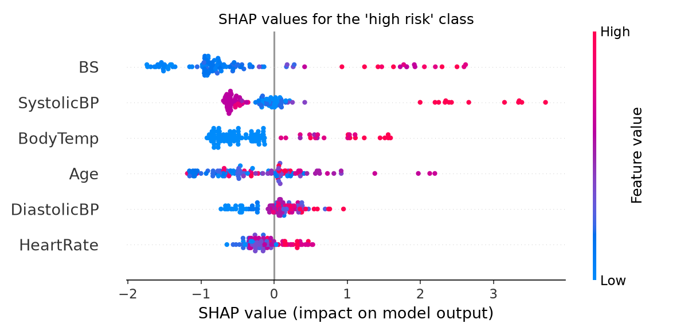
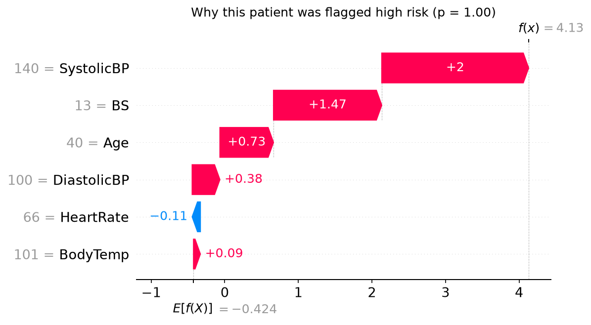

# Maternal Health Risk Prediction with Explainable ML

Predicting maternal health risk (low / mid / high) from six routine vital signs, auditing the
public benchmark for **data leakage**, and explaining predictions with **SHAP**.

## Key findings
- **56% of the dataset is exact duplicate rows** (562 of 1,014). Random cross-validation on the raw
  data puts copies of the same patient in both train and test folds.
- This leakage **inflates macro-F1 by up to 27 points** (Random Forest: 0.855 leaky vs 0.581 clean).
  High reported accuracies on this dataset are largely an artefact of duplicates.
- On the de-duplicated data, **XGBoost performs best (macro-F1 0.60, 5-fold CV)**; high-risk recall is ~0.70.
- SHAP shows **blood sugar** is the strongest driver of high-risk predictions, followed by systolic BP
  and body temperature.

## Results (5-fold stratified CV)

| Setting | Model | Accuracy | Macro-F1 | High-risk recall |
|---|---|---|---|---|
| With duplicates (leaky) | Logistic Regression | 0.603 | 0.606 | 0.757 |
| With duplicates (leaky) | Random Forest | 0.850 | 0.855 | 0.908 |
| With duplicates (leaky) | XGBoost | 0.834 | 0.839 | 0.882 |
| De-duplicated | Logistic Regression | 0.572 | 0.539 | 0.661 |
| De-duplicated | Random Forest | 0.619 | 0.581 | 0.714 |
| De-duplicated | **XGBoost** | **0.670** | **0.602** | 0.696 |

Mean |SHAP| for the high-risk class: BS 1.05, SystolicBP 0.62, BodyTemp 0.61, Age 0.54,
DiastolicBP 0.27, HeartRate 0.24.

| | |
|---|---|
|  |  |

## Data
[UCI Maternal Health Risk dataset](https://archive.ics.uci.edu/dataset/863/maternal+health+risk) —
records from rural health clinics in Bangladesh. Features: Age, Systolic BP, Diastolic BP,
Blood Sugar (mmol/L), Body Temperature (°F), Heart Rate.

Cleaning: removed 2 rows with a heart rate of 7 bpm (recording error), then exact duplicates → 451 unique rows.

## Project structure
```
src/01_eda.py      exploratory analysis and plots
src/02_train.py    leaky vs clean comparison of LR, RF, XGBoost
src/03_explain.py  SHAP global and per-patient explanations
figures/           all plots
results/           metrics.csv, feature_importance.csv
```

## Run
```
pip install -r requirements.txt
python src/01_eda.py
python src/02_train.py
python src/03_explain.py
```

## Limitations
- Small dataset (451 unique rows) from one region; results may not generalise.
- "Mid risk" is hard to separate (F1 ≈ 0.30) — it overlaps heavily with both neighbours.
- No external validation set.
